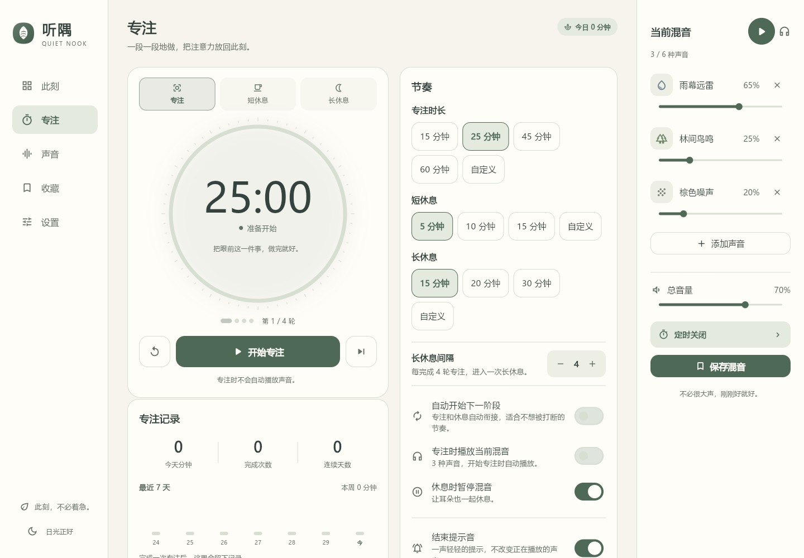
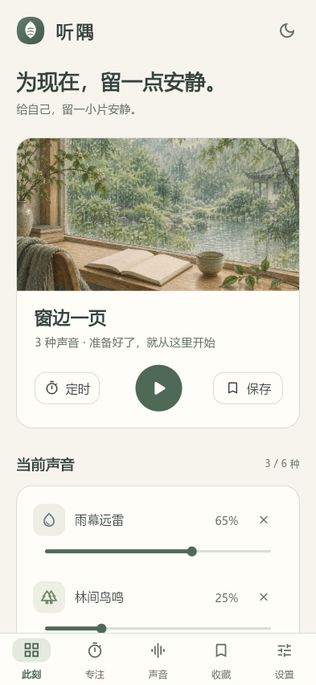
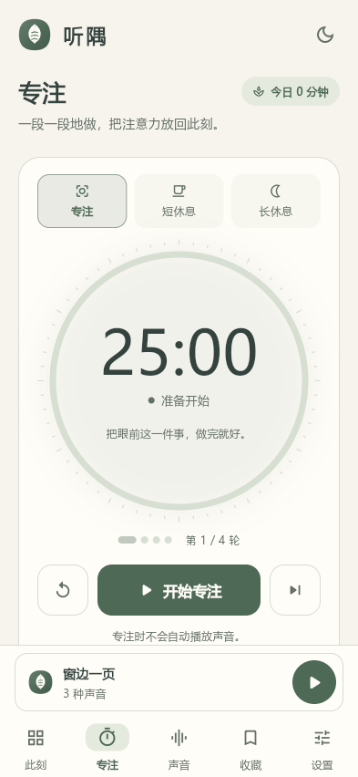
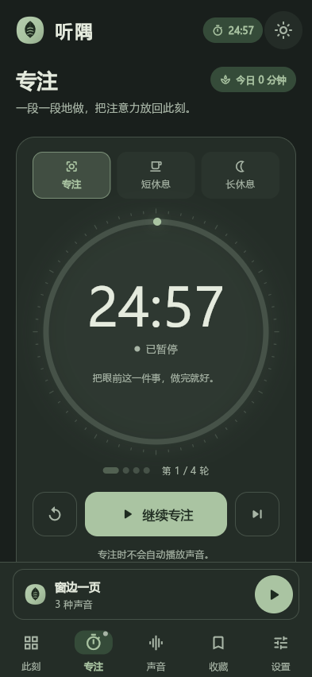
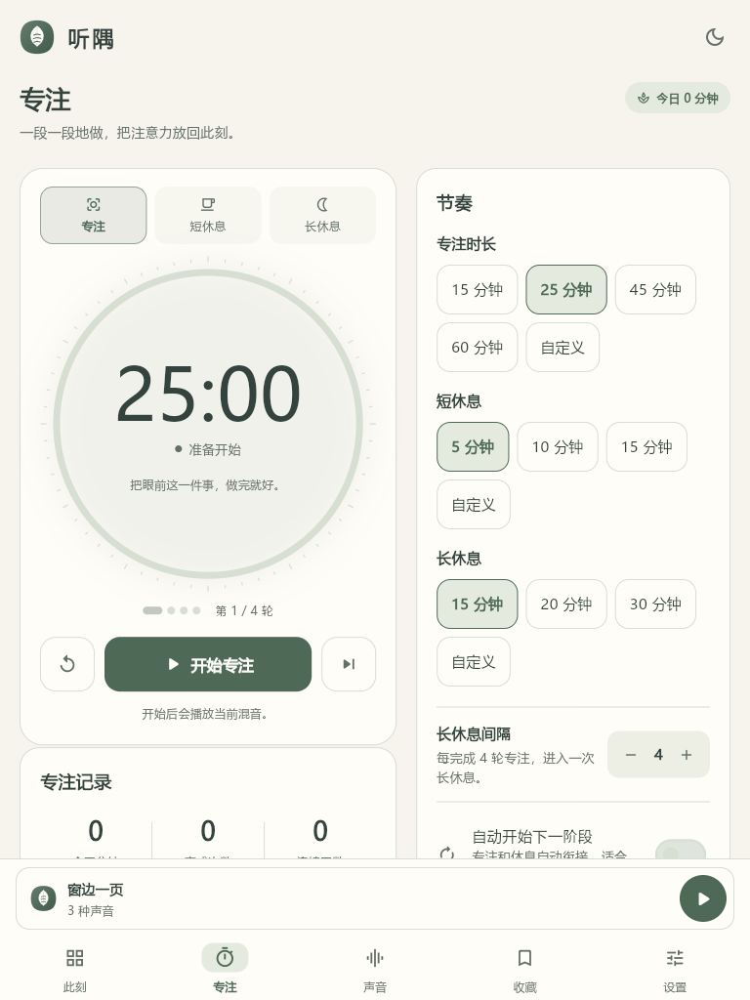
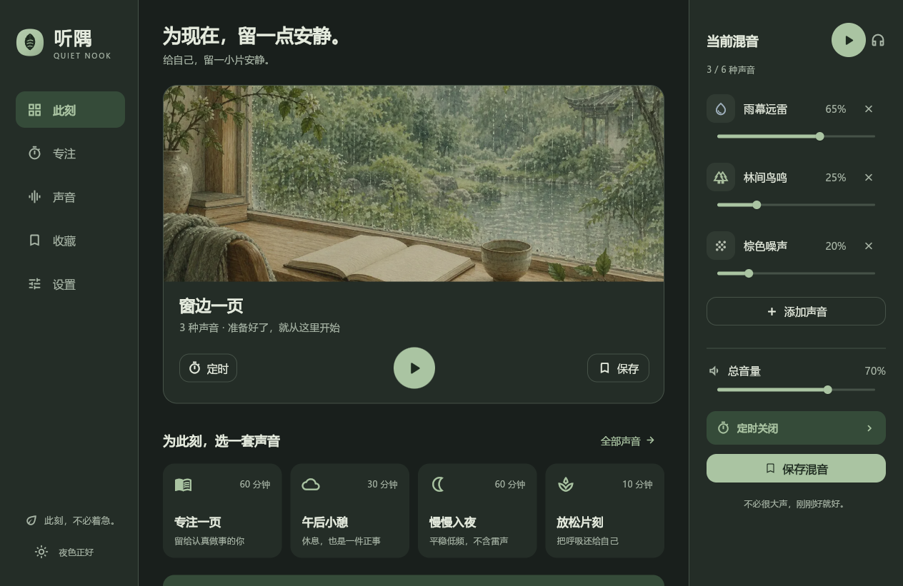

# 听隅 · Quiet Nook

给自己，留一小片安静。

听隅是一款多轨白噪音与专注工具：28 种内置声音自由混音、番茄钟、收藏、定时渐弱、本地导入，覆盖 Web、Windows、Android、iPhone/iPad 与 macOS。



## 下载

安装包与预打包源文件发布在 GitHub Releases：

- [最新版本 Releases](https://github.com/mint041017-tech/tingyu/releases/latest)
- Android：签名 APK（`versionCode 10100 / versionName 1.1.0`，minSdk 23 / targetSdk 35）
- Windows：NSIS 安装包、单文件便携版、免安装 ZIP（x64）
- iOS / iPad：Xcode 工程 + 构建脚本（在 macOS 上产出 IPA）
- macOS：Electron 工程 + 构建脚本（在 macOS 上产出 DMG）
- Web：可直接部署到站点根目录的构建包

校验和随 Release 附件提供（`SHA256SUMS.txt`）。

## 这版有什么

- **专注与休息**：25/45/60 分钟与自定义专注、短休/长休、2–8 轮长休间隔、自动衔接、跳过/重置。
- **不打扰的提醒**：清铃/木鱼提示音与音量、系统通知、页内完成提示；计时结束按真实时间恢复。
- **声音与专注联动**：开始专注自动播放当前混音，休息时自动暂停。
- **专注记录**：今日分钟、完成次数、连续天数、最近 7 天柱状图。
- **动效**：页面淡入位移、导航胶囊、播放键回弹、场景卡悬停；尊重系统与 App 内的“减少动态效果”。
- **新的“声叶”品牌**：叶片 + 三条声波叶脉，覆盖 Web favicon、启动动画、Android/iOS/macOS 应用图标与启动屏。
- **多端壳**：Flutter Web 核心 + Capacitor 7（Android/iOS/iPad）+ Electron 38（Windows/macOS），保留快速首屏 HTML 启动壳。

| 移动端 | 专注 | 深色主题 |
|---|---|---|
|  |  |  |

| iPad 竖屏双栏 | Windows 桌面 | 启动动画 |
|---|---|---|
|  |  |  |

## 本地运行

```bash
cd web_app
flutter pub get
flutter run -d chrome
```

需要 Flutter 3.47+。内置 28 种声音从公开 OBS 按需加载，需要联网；用户导入的个人音频只保存在浏览器 IndexedDB，不会上传。

## 构建与打包

完整的分端构建、签名、预打包说明见 [web_app/README.md](web_app/README.md)。

- Android：Capacitor 7 + Gradle，JDK 21；签名密钥不进入仓库。
- Windows：Electron 38 + electron-builder / electron-packager。
- iOS / iPad：Xcode 工程已生成，`TARGETED_DEVICE_FAMILY=1,2`，需在 macOS 上执行 `packaging/build_ios.sh`。
- macOS：Electron 配置与 icns 已就绪，需在 macOS 上执行 `packaging/build_mac.sh`。
- Web：`flutter build web --release`，部署包已剔除原始 WAV，gzip 旁文件保留。

## 验证

- `flutter analyze`：0 问题；`flutter test`：3 项通过。
- Playwright：移动端/桌面/iPad/小屏均无横向溢出或控制台错误；番茄钟 `25:00 → 24:57`。
- 番茄钟 E2E：刷新后从 `专注 00:52` 恢复；倒计时结束进入短休息，记录 +1、提示音调用 1 次、主题刷新保持。
- 音频：3 路声音同时播放，AudioContext `running`，RMS > 0；提示音调用成功。
- Android APK：`apksigner verify` 通过、`unzip -t` 无错误、版本/权限核验完成。
- Windows：安装包载荷与免安装 ZIP 真实启动，Flutter 首帧、语义树、音频桥正常。
- iOS / macOS：工程、版本、iPad 设备族、启动屏、图标、后台音频与构建脚本静态预检完成。

## 目录

```text
web_app/            Flutter Web 源码、测试、音频桥、品牌组件
web_app/packaging/  Android/iOS 工程、Electron 外壳、图标与构建脚本
design/             品牌标记与视觉探索
docs/screenshots/   实机/浏览器截图
听隅_白噪音App完整设计与Flutter执行方案.md
```

## 说明

- Windows 安装包/便携版未使用商业代码签名证书，首次运行可能出现 SmartScreen 提示；单文件便携版若被安全软件拦截，请使用安装包或免安装 ZIP。
- Android/iOS 原生壳当前使用 Web 通知与页内提醒，后台提醒不保证像系统闹钟一样准时；番茄钟页内已明确说明。
- 内置声音需要联网；导入音频仅保存在本机。
- 仓库未附加开源许可证，默认保留所有权利。
