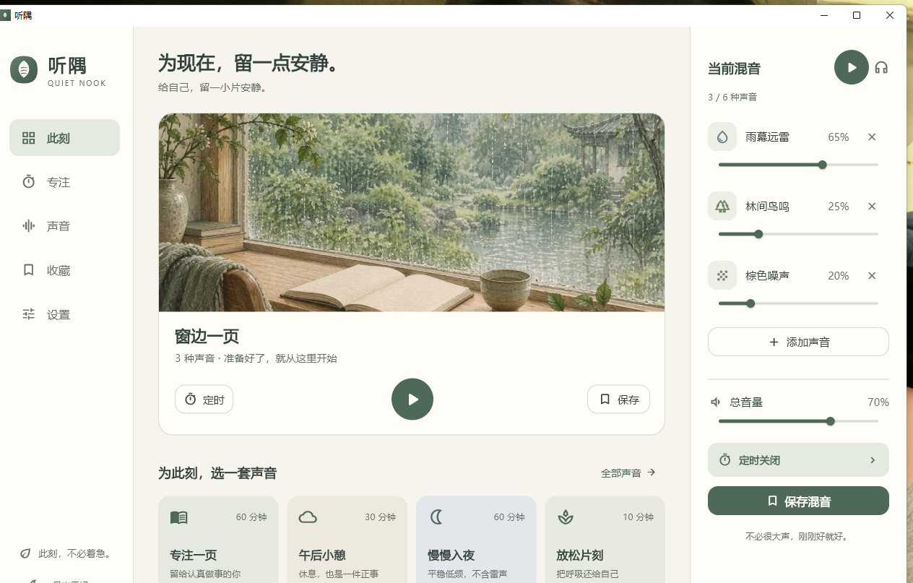
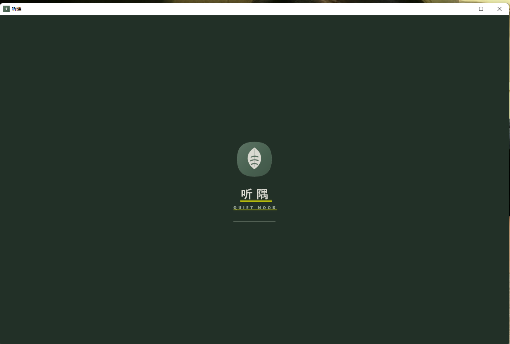

# 听隅 · Quiet Nook

给自己，留一小片安静。

听隅是一款多轨白噪音与专注工具：28 种声音自由混音、番茄钟、收藏、定时渐弱、本地导入，覆盖 Android、iPhone/iPad、Windows、macOS 与 Web。

**2.0.0 已改为原生 Flutter 构建**：Android/iOS/iPad/Windows/macOS 不再使用 WebView 或 Electron 套壳，音频由原生 SoLoud 音频线程混音。



## 下载

- [最新版本 Releases](https://github.com/mint041017-tech/tingyu/releases/latest)
- Android：签名 APK（`com.citro.tingyu`，`versionCode 20000 / versionName 2.0.0`）
- Windows：安装包 / 免安装 ZIP（x64）
- iOS / iPad：Xcode 预打包源文件（在 macOS 上产出 IPA）
- macOS：Xcode 预打包源文件（在 macOS 上产出 APP）
- Web：Flutter Web 部署包（WebAudio，仍保留）

校验和随 Release 附件提供（`SHA256SUMS.txt`）。

## 原生架构

| 平台 | 实现 |
| --- | --- |
| Android | Flutter + SoLoud 原生多轨，6 路循环/音量/淡出，共享草稿/收藏/导入 |
| iPhone / iPad | Flutter + SoLoud + AVAudioSession(`playback`)，iPad 双栏适配 |
| Windows | Flutter + SoLoud + WASAPI，原生窗口/启动动画 |
| macOS | Flutter + SoLoud + CoreAudio，App Sandbox/网络权限已配置 |
| Web | Flutter Web + WebAudio，保留原快速启动壳 |

原生版将 26 段 OBS 录音缓存到本机，并对循环接缝做 0.12 秒交叉淡化；白/粉/棕/水下噪声在原生侧合成。导入音频复制到应用支持目录，收藏/草稿/主题/专注记录写入原生存储。

## 功能

- **专注与休息**：25/45/60 分钟与自定义专注、短休/长休、2–8 轮长休间隔、自动衔接、跳过/重置。
- **提醒**：清铃/木鱼提示音、系统本地通知（Android/iOS/macOS）、Windows 即时通知、页内完成提示。
- **声音联动**：专注自动播放当前混音，休息自动暂停。
- **专注记录**：今日分钟、完成次数、连续天数、最近 7 天柱状图。
- **动效与品牌**：页面淡入位移、导航胶囊、播放键回弹、场景卡悬停；“声叶”标记覆盖图标/启动屏/启动动画。
- **多端布局**：手机、iPhone SE、iPad 竖屏/横屏、Windows 最小窗口、桌面宽屏均已核验。

| 手机 | 专注 | 启动动画 |
|---|---|---|
|  |  |  |

| iPad | Windows |
|---|---|
|  |  |

## 本地运行

```bash
cd web_app
flutter pub get
flutter run
```

Flutter 3.47+。首次播放内置声音需要联网从 OBS 下载，之后复用本机缓存；导入的个人音频只保存在本机，不会上传。

## 构建

完整说明见 [web_app/README.md](web_app/README.md)。

- Android：JDK 21，`flutter build apk --release`，签名密钥不进入仓库。
- Windows：`flutter build windows --release`。
- iOS / iPad：在 macOS 上 `flutter build ios` / Xcode Archive；已配置 iPhone+iPad、后台音频、启动屏与图标。
- macOS：在 macOS 上 `flutter build macos --release`；已配置网络与文件选择 entitlements。
- Web：`flutter build web --release`。

## 验证

- `flutter analyze`：0 error；`flutter test`：模型/存储测试通过。
- Windows 原生集成测试：SoLoud 初始化、3 轨真实播放、定时归零、提示音、收藏持久化全部通过。
- Android APK：`versionCode 20000 / versionName 2.0.0`，`apksigner verify` 通过，`unzip -t` 无错误。
- Windows：原生 Release 真实启动，版本/图标/窗口/启动动画已核验；安装包载荷与免安装 ZIP 使用同一 Release。
- 浏览器回归：移动/桌面/iPad/小屏无横向溢出、无控制台错误；WebAudio 三轨同时播放。
- iOS/iPad/macOS：Bundle、设备族、后台音频、图标、启动屏、entitlements 静态预检；最终二进制需在 Mac 上构建。

## 目录

```text
web_app/lib/             Flutter UI、动效、番茄钟、原生 Web 控制器
web_app/lib/audio/       原生 SoLoud 引擎 + Web 控制器
web_app/lib/platform/    原生通知/提示音/窗口标题
web_app/android|ios|macos|windows/  原生平台工程
web_app/integration_test/ Windows 原生音频集成测试
docs/screenshots/        原生/响应式截图
听隅_白噪音App完整设计与Flutter执行方案.md
```

## 说明

- Android 未接前台服务/MediaSession，长时间锁屏后台仍可能被系统回收；iOS 通过后台音频模式尽量保持。
- Android/iOS 系统提醒使用本地通知；Windows 使用 `local_notifier` 即时通知；不保证像系统闹钟一样准时。
- 原生版不迁移 Web 旧 localStorage/IndexedDB 数据；Web 仍保留原有数据。
- 仓库未附加开源许可证，默认保留所有权利。
